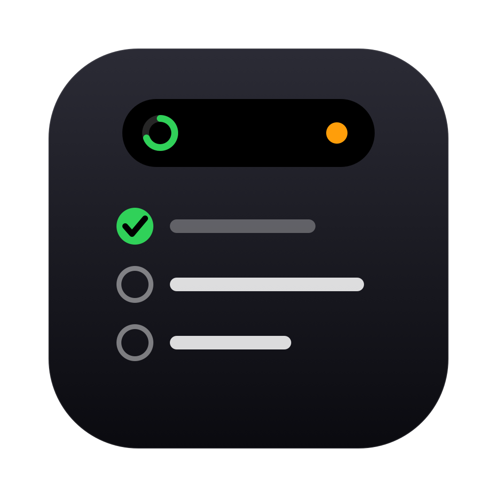
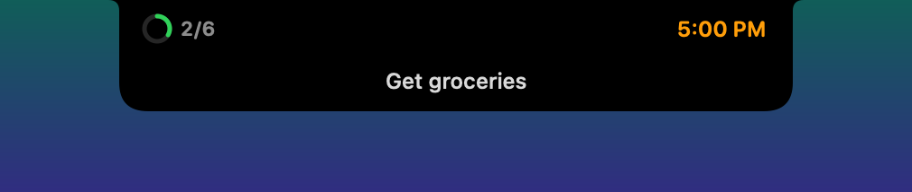
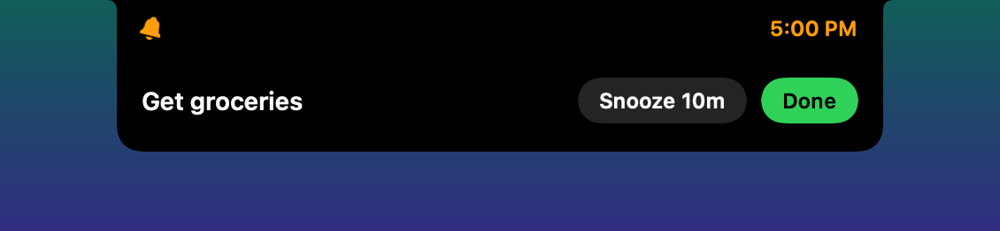

<p align="center"></p>

<h1 align="center">Isle</h1>

<p align="center">A to-do list that lives in your MacBook's notch.</p>


Isle turns the notch into a small Dynamic Island for your tasks. Press **⌃⌥T** from any app, type
`groceries 5pm`, and press Return. The task exists before you lose your train of thought. At 5 PM the
island drops down and asks if it is done.

## What it does

- **Lives in the notch.** When closed, the island hides in the notch. Two small wings show today's
  progress ring and the time of your next task.
- **Peeks on hover.** Point at the notch to see the next task. Click to open.
- **Quick add with plain words.** The trailing words of a task set its day and time. A chip shows where
  the task will go before you press Return.
- **Three lists.** *Today* (with overdue tasks and a "now" line), *Upcoming* (grouped by day), and
  *Backlog* (no date yet).
- **Plan in two clicks.** Hover a row and click ☀︎ to move it to today. Click the calendar to pick a day
  chip, a time chip, or type a phrase like `fri 4pm`.
- **Reminders in the island.** At a task's time, the island expands with **Done** and **Snooze 10m**.
- **Undo.** Delete and move show a short undo bar.
- **Local and private.** Tasks stay in one JSON file on your Mac. No account, no network.

| Closed | Peek | Reminder |
|---|---|---|
|  |  |  |


## Phrases

Isle reads only the **last words** of a task, so "Monday night football" stays a title.

| You type | Isle adds |
|---|---|
| `groceries 5pm` | groceries · today 5:00 PM |
| `call mom tomorrow at 6` | call mom · tomorrow 6:00 PM |
| `dentist fri 3:30pm` | dentist · next Friday 3:30 PM |
| `run tomorrow morning` | run · tomorrow 9:00 AM |
| `taxes apr 30` | taxes · April 30 |
| `renew passport in 3 days` | renew passport · in 3 days |
| `hike this weekend` | hike · Saturday |
| `learn Rust` (on Backlog) | learn Rust · backlog |

- A task with no date goes to the list you are on: today, tomorrow (Upcoming), or the backlog.
- A bare hour needs `at` or `@`: `gym at 7` is 7 AM, `dinner at 6` is 6 PM (1–6 mean PM).
- Day parts: `morning` 9 AM, `noon`, `afternoon` 3 PM, `evening` 6 PM, `tonight` 8 PM.

## Keys

| Key | Action |
|---|---|
| ⌃⌥T | Open the island with the add field focused. Press again to close. |
| Return | Add the task. |
| ⌘1 / ⌘2 / ⌘3 | Today / Upcoming / Backlog |
| Esc | Cancel the edit, clear the field, then close. |
| Right-click | Launch at Login, Show Data File, Quit. |

## Install

You need macOS 14 or later and Xcode 16 or later.

```sh
git clone https://github.com/<you>/Isle.git
cd Isle
Scripts/bundle.sh
```

The script builds a release binary, wraps it in `Isle.app`, signs it ad hoc, installs it in
`~/Applications`, and starts it. Right-click the island and turn on **Launch at Login**.

On a Mac with no notch, Isle draws a notch-sized island at the top center of the main screen.

## How it works

```
Sources/
  IsleCore/        Foundation only, fully unit tested
    Todo.swift         the model and "yyyy-MM-dd" day keys
    Queries.swift      today / upcoming / backlog / progress / next / due
    QuickParse.swift   "dentist fri 3:30pm" → title, day, minute
    Format.swift       "Tomorrow", "Fri, Oct 9 · 3:30 PM"
    TodoStore.swift    @Observable list, saved as JSON after each change
  Isle/            AppKit + SwiftUI
    IslandPanel.swift  borderless NSPanel over the notch
    IslandModel.swift  modes (closed, peek, open, alert), focus, undo
    IslandView.swift   island shape, wings, peek, reminder
    OpenView.swift     tabs, add field, lists
    TaskRow.swift      rows and the schedule editor
    Harness.swift      snapshot and self-test modes for development
```

Some details that took more than one try:

- **No jump on resize.** The window always matches the island, so it never blocks clicks on the menu
  bar. The SwiftUI canvas has one fixed size and is pinned to the top of the window. A resize only clips
  it. If the canvas resized with the window, SwiftUI would lay out one frame late and the island would
  jump.
- **Focus.** A click reaches the non-activating panel without taking focus from your app. Only the
  hotkey activates Isle, and closing hands focus back to the app you were in.
- **Floating days.** A task stores its day as a local `yyyy-MM-dd` key and its time as minutes after
  midnight. 5 PM stays 5 PM when you change time zones.
- **Safe storage.** If `todos.json` does not decode, Isle moves it aside as `todos.corrupt-<time>.json`
  and starts empty. It never overwrites your data.

## Develop

```sh
swift test                                   # parser, queries, and store
ISLE_SELFTEST=1 ISLE_DATA=/tmp/t.json swift run Isle   # drives the panel with real key events
ISLE_SNAPSHOT=/tmp/shots swift run Isle      # saves a PNG of each island state
```

- `ISLE_DATA` points Isle at another data file, so tests and demos never touch your list.
- The harness modes run the panel invisibly and ignore your pointer, so you can keep working.
- `swift Scripts/make-icon.swift` redraws the app icon.

Your tasks live in `~/Library/Application Support/Isle/todos.json`.

## Not yet

Sync, recurring tasks, subtasks, tags, a settings window, and a custom hotkey.

## License

MIT. See [LICENSE](LICENSE).
